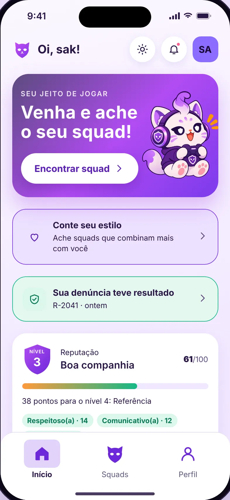
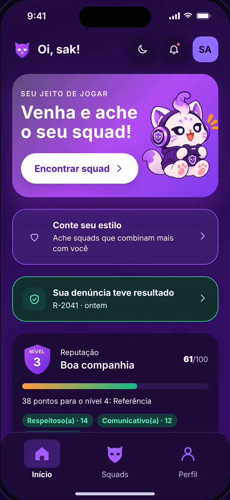
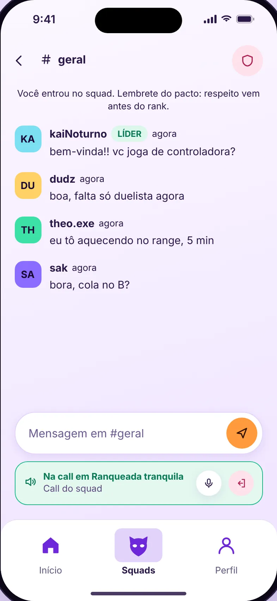

<div align="center">

# 🎮 Squad

**Find teammates for competitive games, without the toxicity.**

Squads with chat and voice, reputation that carries across games, and safety one tap away.

<a href="https://moraeslais.github.io/squad/index.html"></a>&nbsp;&nbsp;&nbsp;<a href="https://moraeslais.github.io/case.html#case-squad"></a>

<br />

&nbsp;&nbsp;
&nbsp;&nbsp;


</div>

## About

In competitive games like Valorant, League of Legends and Counter-Strike, you depend on four strangers to win, and harassment is common. Existing tools are reactive and lonely: mute, block, report and hope.

Squad is a personal concept project: a clickable prototype of an app where you pick your team **by vibe, not rank**, good behavior is visible and bad behavior is costly.

## Features

- 🧭 **Find a squad** by game, vibe and role, with a match score that explains why it fits
- 🛡️ **Tone check** before sending an offensive message
- 🔇 **Voice protection** on calls: strangers stay muted until you let them in
- ⭐ **Reputation** built from praise after each match, carried across games
- 🚩 **Reports with follow-up**, so the reporter knows what happened
- 🌗 **Light and dark themes**, 59 navigable screens

## Built with

- HTML, CSS and vanilla JavaScript, in a single file
- Design in Figma, with its own components and color variables for both themes
- Developed with AI assistance (Claude)

## Run locally

No build step. Clone and open:

```bash
git clone https://github.com/moraeslais/squad-app.git
cd squad-app
python3 -m http.server 8000
# open http://localhost:8000
```

## Notes

- The data in the prototype is fictional.
- Games are mentioned by name only, with no official logos or trademarks.
- The interface is in Portuguese.

---

<div align="center">

Designed and built by **[Laís Moraes](https://moraeslais.github.io)** · Product Designer (UX/UI)

</div>
